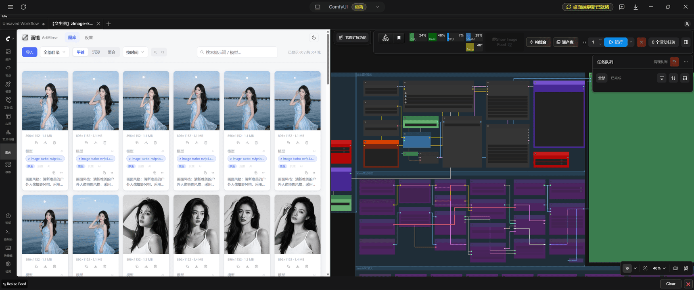
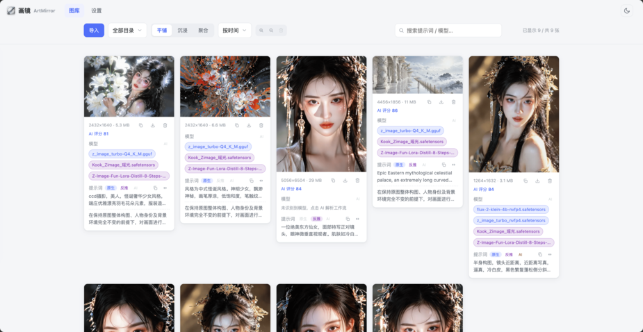
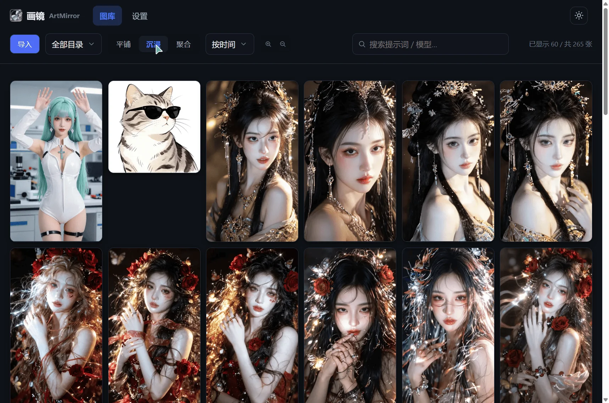
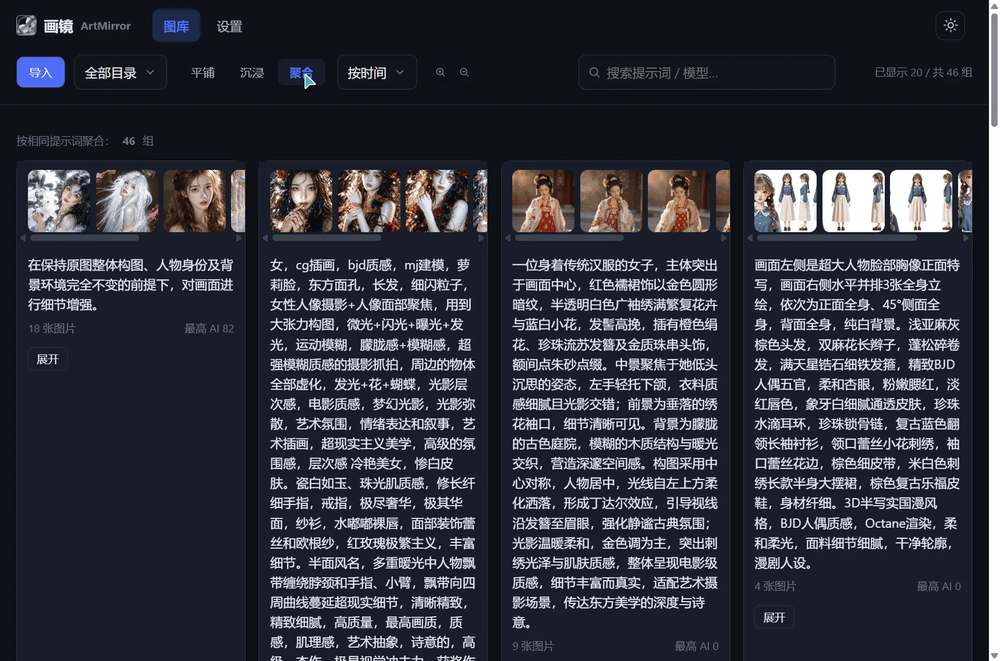
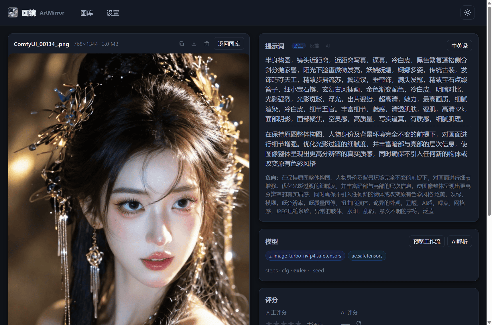
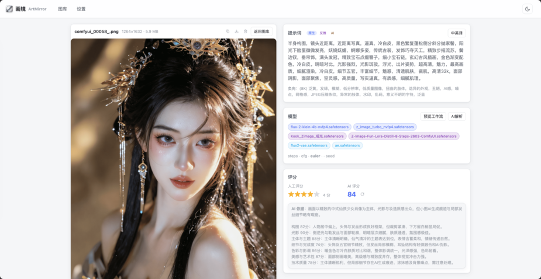
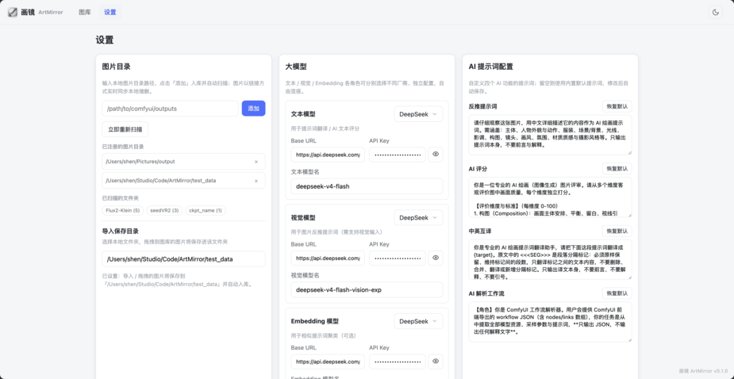

<div align="center">
  
  <h1>ArtMirror</h1>
  <hr />
  <p>
    <strong>A local-first image &amp; prompt asset manager for ComfyUI.</strong><br />
    Browse, organize and search your generated images, parse embedded workflow metadata, and enhance everything with AI.
  </p>
  <p><strong>English</strong> · <a href="README_CN.md">简体中文</a></p>
  <p>
    <a href="https://github.com/ShenZiLi/comfyui-gallery"></a>
    <a href="https://github.com/ShenZiLi/comfyui-gallery"></a>
    
    
    
  </p>
  <p>
    <a href="https://github.com/ShenZiLi/comfyui-gallery">Repository</a> ·
    <a href="#installation">Install</a> ·
    <a href="#features">Features</a> ·
    <a href="#web-app-optional">Web App</a> ·
    <a href="docs/技术文档.md">Docs</a>
  </p>
</div>



***

## Overview

ArtMirror embeds a **Gallery** tab into the ComfyUI sidebar for **browsing, managing and searching locally generated ComfyUI images**. It automatically parses the workflow metadata embedded in PNG files and adds AI capabilities: prompt interrogation, EN↔ZH translation, AI rating and AI workflow parsing.

* **Image asset management**: a background job periodically scans the ComfyUI output directory (or any local image folder) and stores image references plus metadata into SQLite — image bytes are never copied.

* **Workflow metadata parsing**: reads the `workflow` / `prompt` graphs embedded in ComfyUI PNGs and extracts the base model, LoRAs, VAE, sampling parameters and multi-segment prompts.

* **AI enhancement**: plug in any OpenAI-compatible endpoint (mix and match providers) for prompt interrogation, EN↔ZH translation, multi-dimension AI rating and AI workflow parsing.

* **Multi-mode browsing**: flat / immersive / aggregate preview modes, combined with folder filters, tag filters, keyword search and multi-dimensional sorting.

* **Personal single-machine tool**: no authentication; the backend runs inside the ComfyUI process on a temporary `127.0.0.1` port. Plugin data is stored under `ComfyUI/user/artmirror/`.

***

## Installation

ArtMirror is a standard ComfyUI custom node pack — the installation flow is the same as any other node pack. Pick one of the three options below.

### Option 1: Manual install (custom\_nodes)

1. Put the pack into `custom_nodes/`, either way:

   * **git clone** (recommended — easy to upgrade later with `git pull`):

     ```bash
     cd ComfyUI/custom_nodes
     git clone https://github.com/ShenZiLi/comfyui-gallery.git ComfyUI-ArtMirror
     ```

   * **Copy the folder**: this pack is **self-contained** (core `artmirror/` and frontend `static/` are bundled).
     Just copy it as `custom_nodes/ComfyUI-ArtMirror` — **unzip and run**.

2. Dependencies:

   * The pack ships a `requirements.txt` which **ComfyUI installs automatically on startup** (standard mechanism, roughly 1–3 minutes on the first online run). In most cases nothing else is needed.

   * If the automatic install fails, install manually with ComfyUI's Python environment while inside the pack folder:
     ```bash
     pip install -r requirements.txt
     ```
     (dependencies: `fastapi`, `uvicorn`, `sqlmodel`, `pillow`, `httpx`, …)

   * For a fully **offline** package (no internet needed for dependency install), build a release bundle with `_deps/` using `build_plugin.py`. Note that compiled packages inside `_deps` must match ComfyUI's Python version — pass it via `--python`:
     ```bash
     uv run python scripts/build_plugin.py --out build/ComfyUI-ArtMirror --bundle-deps --python 3.12
     ```

3. Fully restart ComfyUI (Desktop or web build) so the pack gets loaded.

4. Open the **Gallery (图库)** tab in the left sidebar — on first open the backend starts in-process and scans the ComfyUI output directory.

### Option 2: ComfyUI-Manager (registry must be published)

Requires [ComfyUI-Manager](https://github.com/ltdrdata/ComfyUI-Manager) (usually bundled with ComfyUI Desktop).

1. Open ComfyUI, click **Manager** in the top bar, go to **Custom Nodes Manager**
2. Type `ArtMirror` (or `ComfyUI-ArtMirror`) into the search box and hit Enter
3. Find **ArtMirror / ComfyUI-ArtMirror** in the results and click **Install**
4. Wait for the download and dependency install to finish — you should see a success message
5. Click **Restart** to restart ComfyUI
6. The **Gallery (图库)** tab appears in the left sidebar after the restart — done

> Note: installing through the node registry requires the pack to be published to Comfy Registry. If it is not published yet the search returns nothing — use Option 1 instead.

### Option 3: Let an AI agent install it (e.g. WorkBuddy)

Send the prompt below to an AI assistant (WorkBuddy / Claude / Code and similar agents) and it will handle download, install and verification. Replace `<your custom_nodes path>` with your real ComfyUI path.

> Install the ComfyUI custom node pack "ArtMirror" (ComfyUI-ArtMirror):
>
> 1. Clone `https://github.com/ShenZiLi/comfyui-gallery.git` into `ComfyUI/custom_nodes/ComfyUI-ArtMirror` (custom\_nodes path: `<your custom_nodes path>`; create it if missing)
> 2. The pack bundles local `_deps/`, so dependency installation is usually unnecessary. If ComfyUI reports missing dependencies, install them with ComfyUI's Python environment according to `[project].dependencies` in `pyproject.toml`
> 3. Walk me through a **full restart** of ComfyUI
> 4. After the restart, confirm the **Gallery (图库)** tab shows up in the left sidebar. If it is blank or returns 503, inspect the `ComfyUI/user/artmirror/` directory and the ComfyUI console log, then fix the issue

### Usage

* The **Gallery (图库)** tab shows up in the sidebar. If the standalone ArtMirror app is installed as well, both offer the same features with independent data.

* Data location: `ComfyUI/user/artmirror/` (database + thumbnails + logs)

* Default scan root: the ComfyUI output directory; change or add scan folders in the settings page inside the tab

* After configuring an LLM, click **Test connection** to enable interrogation / translation / rating

***

## Data & Storage

* SQLite stores only image references (absolute path + SHA-256) and metadata, never image bytes; thumbnails are cached as `<sha>.webp`

* Images are identified by their normalized absolute path; SHA-256 is used for content identity and thumbnail caching. Deletion goes through the system trash (soft delete + physical recycle)

* Wipe all data = delete the `user/artmirror/` directory

## Tech Stack

| Layer | Tech                                                                                                              |
| ----- | ----------------------------------------------------------------------------------------------------------------- |
| Backend | Python 3.11+ · FastAPI · SQLModel (SQLite) · Pillow · httpx — started in-process with ComfyUI (uvicorn on a temporary port) |
| Frontend | Zero-build static pages · Alpine.js (local vendor) · hand-written HTML/CSS/JS                                     |
| Integration | `/artmirror/*` reverse-proxied to the in-process FastAPI app; `WEB_DIRECTORY` registers the sidebar extension      |

***

## Web App (Optional)

Without ComfyUI, the repository also runs as a standalone web tool (browse / manage any local image folder — same features, data independent from the plugin).

| Platform | Launch |
| -------- | ------ |
| macOS | Double-click `启动Web端-Mac.command` (installs dependencies on first run, then opens the browser) |
| Windows | Double-click `启动Web端-Win.bat` (installs dependencies, then opens the browser) |

Manual launch (requires [uv](https://docs.astral.sh/uv/)):

```bash
uv sync
uv run uvicorn launchers.web.main:app --host 0.0.0.0 --port 8000
# open http://127.0.0.1:8000/gallery.html
```

Web app data lives in `data/` at the repository root (SQLite + thumbnails). Wipe it = delete `data/artmirror.db` and `data/thumbs/`.

## Features

All screenshots below come from a running instance.

### 🖼️ Gallery Browsing

Gallery home: a top toolbar (import / folder filter / view switch / sorting / search / zoom), a folder tree on the left, and a card grid in the main area. Each card shows a thumbnail, dimensions, file size, model tags, AI score, prompt and action entries.



* **Three preview modes**

    * **Flat**: cards + prompts (most information)

    * **Immersive**: pure image wall (focus on looking)

    * **Aggregate**: grouped by identical / similar prompts (similarity threshold 0.92) — reuse a whole group's prompt with one click

* **HD preview**: when zooming in to 4 columns or fewer, cards automatically switch to full-resolution images (HD badge)

* **Import**: import images or folders; local folders keep their relative structure and are registered as scan roots automatically

* **Page motion**: mode switching, vertical paging between folders, search fade-in and navigation fades





### 🔍 Search & Management

* Folder filter with three synchronized modes, tag filters (model / LoRA / VAE / style), keyword search across prompts, negative prompts and file names with highlighted results

* Multi-dimensional sorting: time / AI score / manual score

* Large libraries: paginated lists with infinite scrolling — thousands of images scroll smoothly

* Deletion goes to the system trash (recoverable), plus copy image and download original

### 🖼️ Image Details

Click a card to open the details view: the original image on the left, an info panel on the right with prompts, model and sampling parameters, and scores.

* **Prompts**: switch between native / interrogated / AI sources, multi-segment display, click a segment to copy it, EN↔ZH translation

* **Model & parameters**: base model / LoRA / VAE tags, steps / cfg / sampler / scheduler / seed, preview and export workflow (drag back into ComfyUI to reproduce)

* **Scoring**: manual star rating (1–5) + multi-dimension AI rating (0–100 with rationale)

  

### ✨ AI Enhancement

* **EN↔ZH translation**: AI translation, persisted — existing translations switch instantly without another request

* **AI prompt interrogation**: a vision model reads the image and reconstructs the prompt, comparable side by side with the native / AI-parsed prompt

* **AI rating**: a vision model scores the image with rationale; the rating prompt is customizable in settings



### ⚙️ Settings

Configuration hub: scan folders, scanned folder management, import target folder, three LLM roles with connectivity tests, and custom AI prompts.

* **Folder management**: register / remove scan roots; scanned folders show as chips that can be hidden or restored

* **Import target folder**: set the destination for imported / dragged images (falls back to the app-managed data area when unset)

* **LLMs**: independently configure text / vision / embedding roles (DeepSeek / Qwen / GLM / OpenAI / custom) with one-click concurrent connectivity tests

* **AI prompts**: four prompt groups — interrogation, rating, translation and workflow parsing — are customizable



***

## License

MIT
